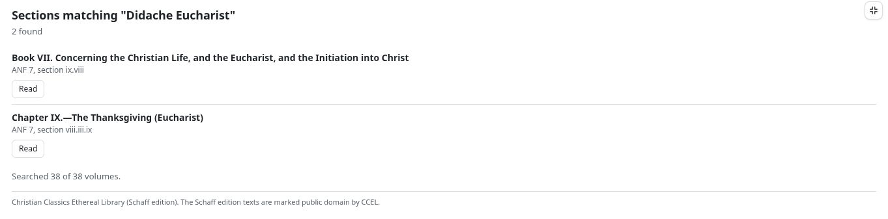

# Sermon Prep

Build a sermon from the passage outward, with parallel translations, original-language notes, early Christian sources and a private place for the manuscript.

[Connect with Claude, ChatGPT, Muse Code, or Grok](PROVIDERS.md)

Trace a verse through the early church, read a paragraph on either side of a quotation, and carry its citation into your preaching notes. The passage desk keeps drafts by version. When you are ready for Sunday, turn saved material into a handout or small-group guide.

## Try it

- “Study John 15:1–5 and find one early interpretation I can read in context.”
- “Show my most recent sermon on Romans and open its latest draft.”
- “Turn the saved notes for my sermon into a small-group guide.”

## Get started in Claude

In Claude Code, run these commands in a session and reload plugins if prompted.

```text
/plugin marketplace add OpZero-sh/plugins
/plugin install sermon-prep@opzero
```

In Claude chat or Cowork, open the installed plugin’s Connectors tab and connect the public Scripture Lookup and Church Fathers Library services. Sign in to Sermon Prep to use the passage desk and your private sermon library. Scripture and historical searches send references or keywords to the public connectors. The private desk receives the sermon text, title, dates, citations and notes you ask it to store. Exports are returned to you in Claude.

## In use

Examples from the connected services in Claude.


